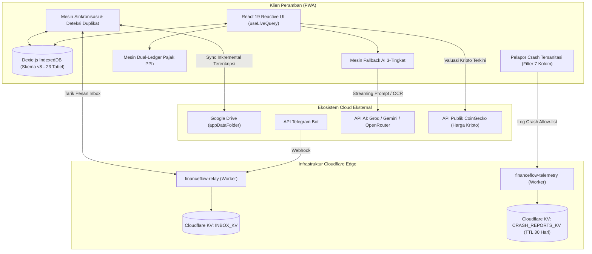
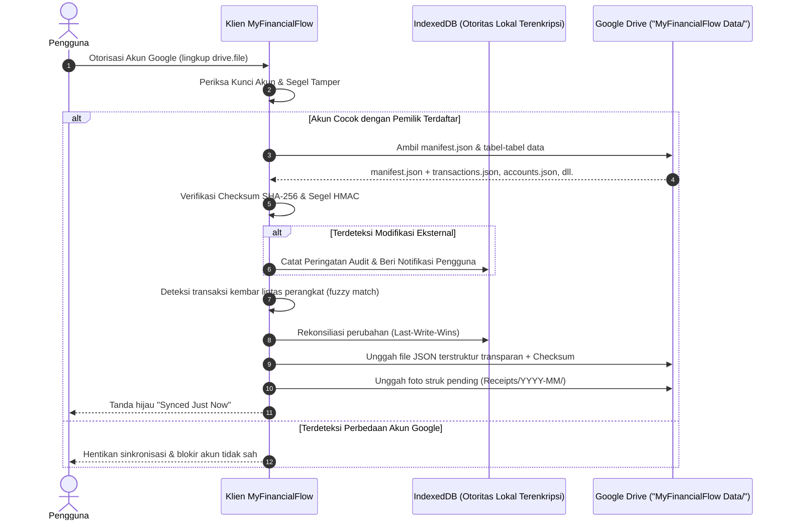
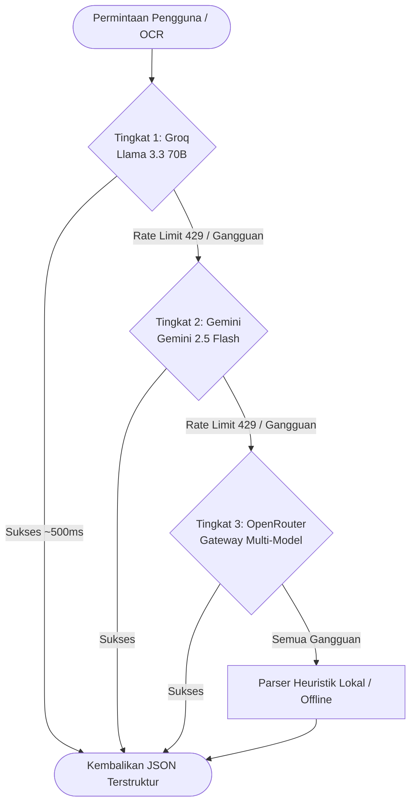

> [!NOTE]
> **Dokumentasi Dwibahasa / Bilingual Documentation**
> - Read this system architecture in **English**: [ARCHITECTURE.md](file:///c:/MyFinancialFlow%20V1.1/ARCHITECTURE.md)
> - Kembali ke Dokumentasi Utama: [README.id.md](file:///c:/MyFinancialFlow%20V1.1/README.id.md)

# MyFinancialFlow V1.1 — Arsitektur Sistem & Spesifikasi Teknis

Dokumen ini menguraikan arsitektur perangkat lunak, model data, protokol sinkronisasi, infrastruktur komputasi edge, dan batasan keamanan yang diimplementasikan di **MyFinancialFlow V1.1**.

---

## 1. Ikhtisar Arsitektur Tingkat Tinggi

MyFinancialFlow V1.1 menerapkan arsitektur **Offline-First, Transparent Cloud-Augmented**. Aplikasi utama berjalan sepenuhnya di dalam peramban (browser) pengguna, dengan database IndexedDB lokal sebagai sumber kebenaran data (*source of truth*). Penyimpanan remote Google Drive berfungsi sebagai repositori transparan dan mudah dibaca oleh manusia untuk data keuangan dan foto struk menggunakan izin lingkup `drive.file`.



---

## 2. Arsitektur Database (Dexie Skema v8)

MyFinancialFlow mengelola seluruh data lokal menggunakan **Dexie.js 4.0** di atas IndexedDB peramban. Database telah berevolusi hingga **Skema Versi 8**, memuat **23 tabel relasional** lengkap dengan migrasi otomatis bertingkat yang menjamin data pengguna tidak hilang saat versi aplikasi diperbarui.

### 2.1 Peta Lengkap Tabel & Indeks Database

| Nama Tabel | Primary Key | Indeks Utama & Multi-Entry | Fungsi Utama |
| :--- | :--- | :--- | :--- |
| `accounts` | `id` | `name, type, currency, isArchived, updatedAt` | Rekening bank, dompet tunai, e-wallet, kartu |
| `categories` | `id` | `name, type, isDefault, isArchived, updatedAt` | Taksonomi kategori pengeluaran dan pemasukan |
| `transactions` | `id` | `accountId, categoryId, date, type, isTaxable, taxTreatment, syncStatus, isExcludedFromBudget, isRecurring, updatedAt` | Buku besar transaksi utama (ledger) |
| `budgets` | `id` | `categoryId, month, period, updatedAt` | Target anggaran per kategori dan periode |
| `recurring_bills` | `id` | `accountId, categoryId, frequency, nextDueDate, isActive, updatedAt` | Langganan dan tagihan rutin terjadwal |
| `debt_items` | `id` | `type, lenderOrBorrower, isSettled, dueDate, updatedAt` | Pinjaman, piutang, dan pelacakan jatuh tempo |
| `user_settings` | `key` | `updatedAt` | Preferensi pengguna, hash PIN, API key terenkripsi |
| `sync_meta` | `id` | `key, updatedAt` | Vector clock, riwayat sinkronisasi, catatan tombstone |
| `monthly_snapshots` | `month` | `totalIncome, totalExpenses, netSavings, updatedAt` | Rekapitulasi histori performa bulanan |
| `ai_rate_limits` | `id` | `provider, model, resetAt, updatedAt` | Metadata pelacakan batas penggunaan token per provider AI |
| `audit_log` | `id` | `entity, entityId, action, timestamp` | Catatan audit trail lokal yang tahan manipulasi |
| `telegram_inbox` | `id` | `chatId, status, date, updatedAt` | Antrean penampungan transaksi dari bot Telegram |
| `receipt_scans` | `id` | `transactionId, status, scannedAt, updatedAt` | Riwayat pemindaian OCR dan token teks hasil ekstraksi |
| `fx_rates` | `currency` | `baseCurrency, date, updatedAt` | Cache nilai tukar mata uang asing |
| `sync_duplicates` | `id` | `status, candidateCount, transactionIds, detectedAt, updatedAt` | Hasil deteksi transaksi kembar lintas perangkat |
| `subscription_patterns`| `id` | `merchantName, estimatedAmount, frequency, status, updatedAt` | Pola langganan berulang yang terdeteksi otomatis |
| `ai_chat_sessions` | `id` | `title, updatedAt` | Riwayat sesi percakapan dengan asisten AI |
| `receipt_attachments`| `id` | `transactionId, mimeType, createdAt` | File gambar struk asli terkompresi (Blob/Base64) |
| `financial_goals` | `id` | `status, targetDate, linkedAccountId, updatedAt` | Target tabungan dengan kalkulasi proyeksi kecepatan |
| `investment_assets` | `id` | `type, symbol, currency, isArchived, updatedAt` | Aset saham, reksadana, kripto, emas, dan properti |
| `asset_valuations` | `id` | `assetId, date, updatedAt` | Log riwayat nilai valuasi berkala per aset |
| `achievements` | `id` | `category, unlockedAt, updatedAt` | Status lencana prestasi dan gamifikasi finansial |

---

## 3. Mesin Dual-Ledger Estimator Pajak PPh Indonesia

Estimator Pajak PPh menyelesaikan persoalan mendasar dalam pencatatan keuangan: **memisahkan penerimaan bruto kena pajak dari arus kas riil di rekening bank**.

Ketika seorang kreator afiliasi menerima komisi Shopee sebesar Rp 10.000.000, Shopee otomatis memotong PPh 21 sebesar Rp 250.000 dan mentransfer nilai bersih Rp 9.750.000 ke rekening bank. Jika hanya dicatat Rp 9.750.000, pelaporan pajak akan kekurangan nilai bruto. Sebaliknya, jika dicatat Rp 10.000.000 di rekening, saldo bank akan selisih lebih Rp 250.000 dari kenyataan mutasi bank.

### 3.1 Alur Dual-Ledger

```
[Pemberi Penghasilan: Shopee / Kantor]
       │
       ├── Penghasilan Bruto Kena Pajak: Rp 10.000.000 ─┐ (Masuk Sub-sistem Pajak)
       │                                               │
       ├── Bukti Potong (Kredit PPh 21): Rp 250.000 ────┼──> Pengurang PPh Terutang
       │                                               │
       └── Kas Bersih Diterima: Rp 9.750.000           │
               │                                       │
               ▼                                       ▼
       [Buku Besar Rekening Bank]           [Kalkulator Pajak Tahunan]
       (Saldo bertambah: +Rp 9.750.000)     - Akumulasi Bruto Tahunan
                                            - Gabung Gaji Pokok Kantor (Baseline)
                                            - Kurangkan Single PTKP (TK/0 - K/3)
                                            - Hitung PKP (Penghasilan Kena Pajak)
                                            - Terapkan Tarif Progresif (5%-35%)
                                            - Kurangkan Kredit Bukti Potong
                                            - Hasil: Kurang / Lebih Bayar PPh
```

### 3.2 Implementasi Prinsip Single-PTKP
Berdasarkan ketentuan perpajakan Indonesia (UU HPP), PTKP (Penghasilan Tidak Kena Pajak) hanya boleh dikurangkan **satu kali untuk total penghasilan seorang wajib pajak dalam satu tahun pajak**, menggabungkan gaji tetap kantor dan penghasilan sampingan.

Mesin pajak mengimplementasikan aturan ini melalui kolom opsional: `otherIncomeTaxAccounted` (Gaji kantor yang sudah dipotong PPh 21 oleh pemberi kerja).
1. $\text{Total Bruto} = \sum(\text{Bruto Transaksi Sampingan}) + \text{Gaji Pokok Kantor}$
2. $\text{PKP Gabungan} = \max(0, \text{Total Bruto} - \text{PTKP})$
3. $\text{Total PPh Terutang} = \text{HitungTarifProgresif}(\text{PKP Gabungan})$
4. $\text{Sisa Pajak Disetor} = \max(0, \text{Total PPh} - \text{Total Bukti Potong} - \text{PPh 21 Gaji Kantor})$

---

## 4. Arsitektur Sinkronisasi Cloud & Penyimpanan Transparan Google Drive (V1.1)

Pada V1.1, MyFinancialFlow beralih ke **model penyimpanan cloud transparan**. Data disinkronkan langsung ke Google Drive pengguna di dalam folder yang terlihat dan dapat diakses langsung (`MyFinancialFlow Data/`) menggunakan izin dengan prinsip hak akses terkecil (`drive.file`, dibatasi hanya pada file/folder yang dibuat atau dibuka oleh aplikasi ini).



### 4.1 Analisis Postur Keamanan & Keputusan Tradeoff (Evolusi V1.1)

> [!WARNING]
> **Penghapusan Sadar Enkripsi Zero-Knowledge Remote**:
> Pada V1.0, data yang dikirim ke Google Drive dienkripsi AES-GCM-256 menggunakan PIN master di folder tersembunyi `appDataFolder`.
> 
> Mulai **V1.1**, pengguna secara sadar dan sengaja memprioritaskan **transparansi, kemudahan membaca data langsung, dan portabilitas**:
> 1. **Data Sinkronisasi di Google Drive Tidak Dienkripsi**: Seluruh tabel keuangan inti (`transactions.json`, `accounts.json`, `categories.json`, `goals.json`, `investments.json`, `metadata.json`) disimpan sebagai file JSON terstruktur yang bersih dan dapat dibaca langsung oleh manusia di folder `MyFinancialFlow Data/`.
> 2. **Foto Struk Dapat Dilihat Langsung**: Foto struk dan bukti transfer disimpan sebagai file gambar standar JPEG di subfolder `MyFinancialFlow Data/Receipts/YYYY-MM/` dan dapat dibuka langsung melalui aplikasi Google Drive di ponsel maupun komputer tanpa membuka aplikasi MyFinancialFlow.
> 3. **Implikasi Keamanan Praktis**: Jika akun Google pengguna diretas atau disusupi pihak ketiga, peretas yang memiliki akses ke Google Drive dapat membaca file keuangan dan foto struk di folder `MyFinancialFlow Data/`.
> 4. **Keamanan Perangkat Lokal Tetap Terjaga 100%**: Database **IndexedDB pada perangkat lokal** dan **cadangan harian OPFS (`.enc`)** TETAP mempertahankan enkripsi penuh AES-GCM-256 dengan Master PIN. Kunci aplikasi, biometrik, dan proteksi PIN di perangkat lokal tidak mengalami penurunan keamanan sama sekali.

### 4.2 Mekanisme Bukti Tamper (Tamper-Evidence) Ringan

Karena file data di Google Drive kini tersimpan dalam format JSON terbuka yang dapat diedit langsung, V1.1 mengimplementasikan sistem bukti tamper kriptografis untuk mendeteksi perubahan manual tanpa izin atau pembajakan brankas:
1. **Integritas Checksum SHA-256 per File**:
   - Saat menulis data, aplikasi menghitung digest SHA-256 untuk setiap file data (`transactions.json`, `accounts.json`, dll.) dan menyimpannya di dalam `manifest.json`.
   - Saat mengunduh data, aplikasi mencocokkan hash file yang diunduh dengan checksum di manifest. Jika ada file yang diedit dari luar (misal diedit manual di web Google Drive), aplikasi segera mendeteksi ketidakcocokan, menampilkan peringatan, dan mencatatnya ke audit trail sebelum melakukan rekonsiliasi hati-hati dengan LWW.
2. **Perlindungan Kunci Akun Google (Google Account Lock) dengan Segel HMAC**:
   - Nilai `approvedAccountId` pada `manifest.json` disegel dengan tanda tangan digital HMAC-SHA256 menggunakan PIN Master pengguna (`approvedAccountSeal`).
   - Jika pihak luar mencoba mengubah `approvedAccountId` secara paksa di Google Drive untuk membajak brankas data, validasi segel akan gagal dan sinkronisasi **langsung diblokir keras**, melindungi integritas data pengguna.
   - Pergantian akun Google resmi hanya dapat dilakukan melalui menu ber-PIN "Ubah Akun Google Terhubung" di Pengaturan.

### 4.3 Penyimpanan Foto Struk & Kebijakan Pruning Cache Offline

1. **Model Penyimpanan Ganda**:
   - **Google Drive (Master Permanen)**: Berfungsi sebagai tempat penyimpanan utama permanen untuk foto struk (`MyFinancialFlow Data/Receipts/YYYY-MM/rcpt_*.jpg`). Setiap transaksi menyimpan URL `receiptUrl` langsung ke `webViewLink` file Google Drive.
   - **IndexedDB (Cache Offline Lokal)**: Menyimpan salinan kompresi gambar lokal agar pengguna dapat membuka struk secara instan saat tidak ada koneksi internet.
2. **Pembersihan Cache (Pruning) terhadap Batas 2.0 GB**:
   - Agar ruang penyimpanan perangkat lokal tidak terus membengkak melewati batas 2.0 GB, foto struk yang telah terkonfirmasi aman tersimpan di Google Drive dapat dibersihkan data base64 lokalnya (`isPruned: true`, `dataBase64: undefined`).
   - Proses pruning ini memulihkan 100% ruang memori lokal yang dipakai oleh struk tersebut, tanpa menghapus catatan transaksi dan tetap mempertahankan tautan cloud Google Drive.
3. **Catatan Penting Akses Struk Saat Offline**:
   > [!IMPORTANT]
   > Melihat foto struk transaksi lama saat perangkat sepenuhnya offline hanya dapat dilakukan jika foto struk tersebut masih tersimpan di dalam cache lokal perangkat. Jika foto struk lama telah dipruning (dibersihkan dari cache lokal untuk menghemat memori), membuka foto struk asli memerlukan koneksi internet aktif untuk memuat gambar langsung dari Google Drive via tautan `receiptUrl`. Foto struk baru atau yang belum dipruning tetap dapat diakses offline seperti biasa.

---

## 5. Mesin Fallback AI 3-Tingkat

Asisten AI (`ai.ts`) mengelola ekstraksi cerdas dari foto struk, instruksi chat, dan rekaman suara menggunakan sistem cascade 3-tingkat:



### Keunggulan Desain AI:
- **Kunci Rahasia Zero-Build**: Kredensial API disimpan terenkripsi di IndexedDB peramban, tidak pernah ditulis di source code repositori.
- **Pemantauan Kesehatan**: Pengecekan latensi dan batas kuota berkala memastikan sistem otomatis memilih penyedia paling responsif.
- **Validasi Skema JSON**: Setiap respon AI divalidasi strukturnya sebelum dimasukkan ke dalam database.

---

## 6. Cloudflare Edge Workers & Telemetri Berprinsip Privasi

### 6.1 `financeflow-relay` (Relay Webhook Telegram)
- Menerima webhook HTTP POST dari API Bot Telegram.
- Menampung antrean pesan dan URL foto secara aman di Cloudflare KV (`INBOX_KV`).
- Menerapkan enkripsi muatan berbasis PIN rahasia pengguna, sehingga worker tidak dapat membaca isi pesan transaksi.
- Tidak pernah mencatat atau bersentuhan dengan API key bank atau AI milik pengguna.

### 6.2 `financeflow-telemetry` (Pelapor Crash Berprinsip Privasi)
- Pengiriman laporan diagnostik bersifat opt-in (sukarela).
- **Filter Ketat 7 Kolom (Allow-list)**: Menolak setiap data di luar 7 kolom teknis berikut:
  `errorName`, `errorMessage`, `componentStack`, `url`, `userAgent`, `timestamp`, `version`.
- **Jaminan Nol Data Finansial**: Nama transaksi, nama akun, saldo, nominal, dan API key secara matematis tidak dapat dikirimkan karena langsung dibuang oleh filter skema.
- **Penyimpanan Permanen KV dengan Auto-TTL**: Disimpan durabel di Cloudflare KV (`CRASH_REPORTS_KV`) dengan masa kedaluwarsa otomatis 30 hari (`expirationTtl: 2592000`).

---

## 7. Metrik Kinerja & Ukuran Bundle

- **Ukuran Bundle Awal**: ~320–330 kB gzip (mencakup pustaka Chart.js, ikon Lucide, dan Dexie).
- **Time to Interactive (TTI)**: < 600ms pada koneksi seluler standar 4G.
- **Latensi Kueri Database**: < 5ms untuk kueri berindeks menggunakan Dexie `useLiveQuery`.
- **Cakupan Pengujian Otomatis**: 27 test suite integrasi selesai dalam tempo < 15 detik.
