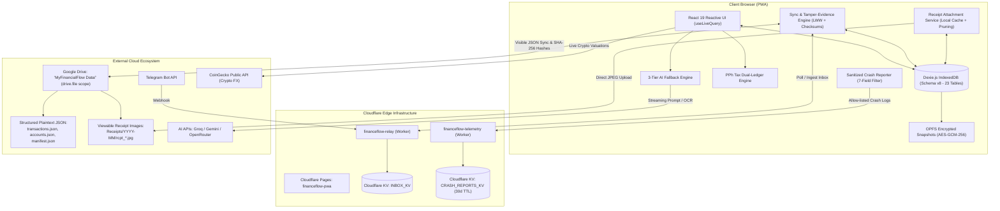
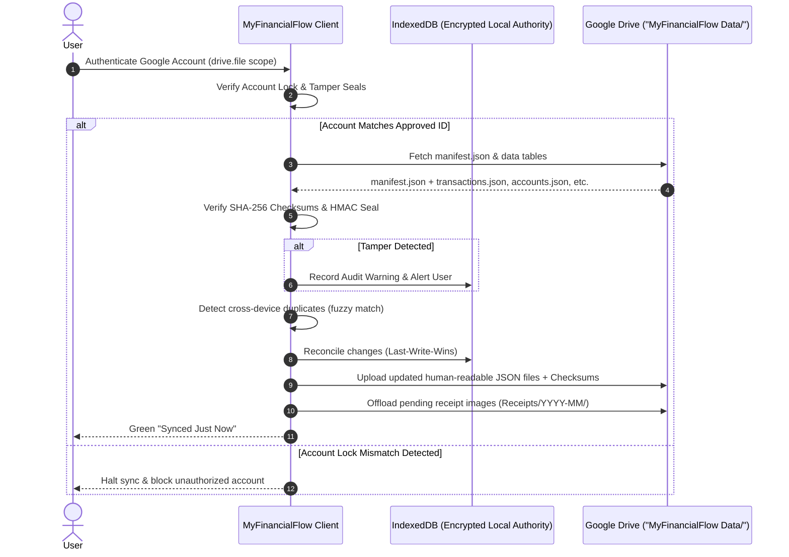
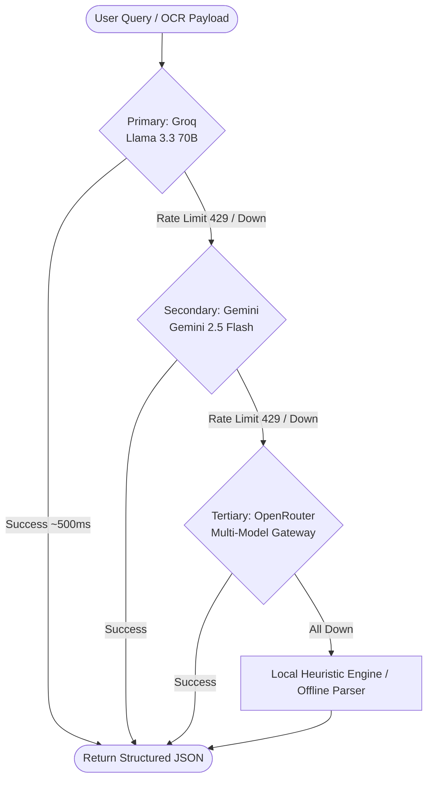

> [!NOTE]
> **Bilingual Documentation / Dokumentasi Dwibahasa**
> - Baca arsitektur sistem ini dalam **Bahasa Indonesia**: [ARCHITECTURE.id.md](file:///c:/MyFinancialFlow%20V1.1/ARCHITECTURE.id.md)
> - Return to Main Documentation: [README.md](file:///c:/MyFinancialFlow%20V1.1/README.md)

# MyFinancialFlow V1.1 — System Architecture & Technical Specifications

This document outlines the software architecture, data models, synchronization protocols, edge infrastructure, and security boundaries implemented in **MyFinancialFlow V1.1**.

---

## 1. High-Level Architecture Overview

MyFinancialFlow V1.1 follows an **Offline-First, Transparent Cloud-Augmented** architecture. The core application runs entirely within the user's web browser, maintaining a local-first source of truth in IndexedDB. Remote Google Drive storage serves as a visible, human-readable repository for financial data and receipt images under the `drive.file` scope.



---

## 2. Database Architecture (Dexie Schema v8)

MyFinancialFlow manages all local state via **Dexie.js 4.0** over IndexedDB. The database has evolved to **Schema Version 8**, containing **23 relational tables** with automatic versioned migrations preserving user data across upgrades.

### 2.1 Complete Table Schema & Index Map

| Table Name | Primary Key | Key Indexes & Multi-Entry Attributes | Purpose |
| :--- | :--- | :--- | :--- |
| `accounts` | `id` | `name, type, currency, isArchived, updatedAt` | Bank accounts, cash wallets, cards |
| `categories` | `id` | `name, type, isDefault, isArchived, updatedAt` | Spending & revenue category taxonomy |
| `transactions` | `id` | `accountId, categoryId, date, type, isTaxable, taxTreatment, syncStatus, isExcludedFromBudget, isRecurring, updatedAt` | Primary double-entry transaction ledger |
| `budgets` | `id` | `categoryId, month, period, updatedAt` | Category and period budget targets |
| `recurring_bills` | `id` | `accountId, categoryId, frequency, nextDueDate, isActive, updatedAt` | Subscriptions and regular recurring obligations |
| `debt_items` | `id` | `type, lenderOrBorrower, isSettled, dueDate, updatedAt` | Loans, debts owed, and receivables |
| `user_settings` | `key` | `updatedAt` | Client-side preferences, PIN hash, API keys |
| `sync_meta` | `id` | `key, updatedAt` | Vector clocks, last sync timestamps, tombstone logs |
| `monthly_snapshots` | `month` | `totalIncome, totalExpenses, netSavings, updatedAt` | Monthly historical performance rollups |
| `ai_rate_limits` | `id` | `provider, model, resetAt, updatedAt` | Rate-limiting metadata per AI vendor |
| `audit_log` | `id` | `entity, entityId, action, timestamp` | Tamper-evident local audit trail |
| `telegram_inbox` | `id` | `chatId, status, date, updatedAt` | Staged incoming transactions from Telegram |
| `receipt_scans` | `id` | `transactionId, status, scannedAt, updatedAt` | OCR processing records and extracted tokens |
| `fx_rates` | `currency` | `baseCurrency, date, updatedAt` | Foreign exchange rate conversion cache |
| `sync_duplicates` | `id` | `status, candidateCount, transactionIds, detectedAt, updatedAt` | Cross-device fuzzy match duplicate detection |
| `subscription_patterns`| `id` | `merchantName, estimatedAmount, frequency, status, updatedAt` | Inferred recurring subscription patterns |
| `ai_chat_sessions` | `id` | `title, updatedAt` | Conversation history for the AI Assistant |
| `receipt_attachments`| `id` | `transactionId, mimeType, createdAt` | Compressed raw receipt images (Base64/Blob) |
| `financial_goals` | `id` | `status, targetDate, linkedAccountId, updatedAt` | Savings targets with velocity projections |
| `investment_assets` | `id` | `type, symbol, currency, isArchived, updatedAt` | Stocks, crypto, gold, and property assets |
| `asset_valuations` | `id` | `assetId, date, updatedAt` | Valuation history logs per investment asset |
| `achievements` | `id` | `category, unlockedAt, updatedAt` | Gamification milestones and badge states |

---

## 3. Indonesian Personal Income Tax (PPh) Dual-Ledger Engine

The PPh Tax Estimator solves a fundamental challenge in personal finance: **separating taxable gross revenue from real cash flow**. 

When an affiliate marketer earns Rp 10,000,000 from Shopee, Shopee withholds PPh 21 (e.g., Rp 250,000) and transfers Rp 9,750,000 to the user's bank account. If only Rp 9,750,000 is logged, the tax calculation under-reports gross income. Conversely, if Rp 10,000,000 is logged to the bank account, the bank balance is artificially inflated by Rp 250,000.

### 3.1 Dual-Ledger Flow

```
[External Payer: Shopee / Employer]
       │
       ├── Gross Taxable Income: Rp 10,000,000 ────────┐ (Logged to Tax Subsystem)
       │                                               │
       ├── Bukti Potong (Tax Withheld): Rp 250,000 ────┼──> Tax Credit Offset
       │                                               │
       └── Net Cash Received: Rp 9,750,000             │
               │                                       │
               ▼                                       ▼
       [Bank Account Ledger]                [Annual Tax Calculator]
       (Balance: +Rp 9,750,000)             - Aggregates Annual Gross
                                            - Combines External Salary Baseline
                                            - Deducts Single PTKP (TK/0 - K/3)
                                            - Calculates PKP (Taxable Income)
                                            - Applies Progressive Brackets (5%-35%)
                                            - Subtracts Withholding Tax Credits
                                            - Outputs: Kurang / Lebih Bayar
```

### 3.2 Single-PTKP Rule Implementation
Under Indonesian tax law (UU HPP), PTKP (Penghasilan Tidak Kena Pajak) applies **once per individual per tax year**, combining both formal employment and side income. 

The engine implements this via an optional baseline field: `otherIncomeTaxAccounted` (employer salary).
1. $\text{Total Gross} = \sum(\text{Flagged Side Income Gross}) + \text{Employer Baseline Gross}$
2. $\text{Combined PKP} = \max(0, \text{Total Gross} - \text{PTKP})$
3. $\text{Gross Tax} = \text{CalculateProgressiveBrackets}(\text{Combined PKP})$
4. $\text{Tax Due} = \max(0, \text{Gross Tax} - \text{Tax Withheld Credits} - \text{Employer PPh 21 Paid})$

---

## 4. Cloud Sync & Visible Google Drive Storage Architecture (V1.1)

In V1.1, MyFinancialFlow transitions to a **visible, transparent cloud storage model**. Data is synchronized directly into the user's Google Drive inside a dedicated, accessible folder (`MyFinancialFlow Data/`) using the least-privilege `drive.file` scope (restricted strictly to files created by or opened with this application).



### 4.1 Security Posture & Tradeoff Analysis (V1.1 Evolution)

> [!WARNING]
> **Deliberate Removal of Remote Zero-Knowledge Encryption**:
> In V1.0, data pushed to Google Drive was encrypted with AES-GCM-256 under the user's master PIN inside the hidden `appDataFolder`. 
> 
> As of **V1.1**, the user has made an informed, deliberate decision to prioritize **transparency, readability, and data portability**:
> 1. **Google Drive Synced Files are Unencrypted**: Core financial records (`transactions.json`, `accounts.json`, `categories.json`, `goals.json`, `investments.json`, `metadata.json`) are stored as clean, structured, human-readable JSON files in the visible `MyFinancialFlow Data/` folder.
> 2. **Viewable Receipt Images**: Scanned receipts and transfer proofs are stored as standard viewable JPEG image files in `MyFinancialFlow Data/Receipts/YYYY-MM/`, accessible directly in Google Drive mobile and desktop applications.
> 3. **Practical Security Implication**: If the user's Google Account itself is ever compromised, an attacker with Google Drive access can read the financial records and view receipt images in the `MyFinancialFlow Data/` folder.
> 4. **Local Device Security Preserved**: The **local on-device database (IndexedDB)** and **local OPFS daily snapshots (`.enc`)** KEEP their full AES-GCM-256 PIN-gated encryption. The app's Master PIN lock, biometric protection, and offline security remain 100% active.

### 4.2 Lightweight Tamper-Evidence Mechanism

Because remote data files are now stored as plain, editable JSON, V1.1 implements a cryptographic tamper-evidence mechanism to protect the user against undetected external modifications or account hijacking:
1. **Per-File SHA-256 Integrity Checksums**:
   - At write time, the app computes a SHA-256 digest over every data file (`transactions.json`, `accounts.json`, etc.) and stores these hashes inside `manifest.json`.
   - On download, the app verifies each file's computed hash against the manifest. If a file was edited externally (e.g., edited directly in Google Drive), the app flags a clear tamper alert and records an audit log before cautious LWW reconciliation.
2. **HMAC-SHA256 Google Account Lock Protection**:
   - The `manifest.json` `approvedAccountId` is sealed using an HMAC-SHA256 signature keyed by the user's Master PIN (`approvedAccountSeal`).
   - If an unauthorized party alters `approvedAccountId` in Google Drive to bypass the lock, the signature verification fails and sync is **hard-blocked**, preventing vault hijacking.
   - Genuine migrations can only be initiated via the PIN-gated "Change Approved Account" flow in Settings.

### 4.3 Receipt Storage & Offline Cache Pruning Policy

1. **Dual Storage Model**:
   - **Google Drive (Durable Master)**: Serves as the permanent, durable repository for receipts (`MyFinancialFlow Data/Receipts/YYYY-MM/rcpt_*.jpg`). Each transaction record stores a direct `receiptUrl` linking to the file's Google Drive `webViewLink`.
   - **IndexedDB (Local Offline Cache)**: Holds compressed JPEG thumbnails to allow instantaneous, offline receipt inspection.
2. **Cache Pruning against 2.0 GB Ceiling**:
   - To prevent unbounded local device storage growth, local base64 image blobs that are confirmed backed up to Google Drive can be pruned (`isPruned: true`, `dataBase64: undefined`).
   - Pruning reclaims 100% of the local storage consumed by that receipt while preserving transaction metadata and the Google Drive cloud link.
3. **Important Offline Receipt Note**:
   > [!IMPORTANT]
   > Viewing older receipts while fully offline requires that the receipt still resides in the local on-device cache. If a receipt has been pruned to reclaim local storage, viewing the original image requires an active internet connection to load from Google Drive via the `receiptUrl`. Newly scanned or un-pruned receipts remain available offline as normal.

---

## 5. Resilient 3-Tier AI Fallback Engine

The AI Assistant (`ai.ts`) coordinates intelligent parsing of receipts, chat commands, and voice transcriptions using a 3-tier cascade:



### Key AI Features:
- **Zero-Build-Time Secrets**: Keys are stored encrypted in the browser's IndexedDB, never embedded in source code or server environments.
- **Health Monitoring**: Proactive ping checks track provider latency, availability, and remaining rate limits.
- **Deterministic JSON Parsing**: Prompts strictly demand structured JSON output with schema validation before applying database writes.

---

## 6. Cloudflare Edge Workers & Zero-Knowledge Telemetry

### 6.1 `financeflow-relay` (Telegram Webhook Relay)
- Receives HTTP POST webhooks from Telegram Bot API.
- Buffers incoming messages and photo URLs in Cloudflare KV (`INBOX_KV`).
- Implements PIN-based payload encryption: only clients possessing the user's secret PIN can decipher and ingest the inbox queue.
- Zero credential logging: the worker never touches the user's AI keys or bank credentials.

### 6.2 `financeflow-telemetry` (Privacy-Preserving Crash Reporter)
- Opt-in error reporting allowing users to contribute diagnostic information.
- **Strict 7-Field Allow-List**: Rejects any request payload containing fields outside:
  `errorName`, `errorMessage`, `componentStack`, `url`, `userAgent`, `timestamp`, `version`.
- **Zero Financial Data Guarantee**: Transaction descriptions, account names, amounts, balances, and keys are mathematically excluded by schema validation.
- **Durable Persistence with Auto-TTL**: Stored in Cloudflare KV (`CRASH_REPORTS_KV`) with an automatic 30-day time-to-live (`expirationTtl: 2592000`).

---

## 7. Performance & Bundle Metrics

- **Initial Bundle Size**: ~320–330 kB gzip (including Chart.js, Lucide icons, and Dexie).
- **Time to Interactive (TTI)**: < 600ms on standard mobile networks.
- **Database Query Latency**: < 5ms for indexed queries using Dexie `useLiveQuery`.
- **Test Coverage**: 27 automated integration test suites executed in < 15 seconds.
