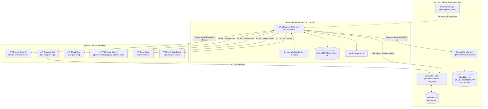
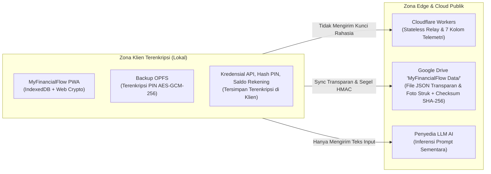

> [!NOTE]
> **Dokumentasi Dwibahasa / Bilingual Documentation**
> - Read this network & deployment topology in **English**: [TOPOLOGY.md](file:///c:/Personal%20Finance/TOPOLOGY.md)
> - Kembali ke Dokumentasi Utama: [README.id.md](file:///c:/Personal%20Finance/README.id.md)

# MyFinancialFlow — Topologi Jaringan & Deployment

Dokumen ini menjelaskan topologi deployment, batasan jaringan, infrastruktur edge, serta matriks kapabilitas offline vs online pada MyFinancialFlow.

---

## 1. Ikhtisar Topologi Jaringan

MyFinancialFlow beroperasi dengan model desentralisasi berpusat pada klien (client-centric). Tidak ada server aplikasi monolitik maupun database backend terpusat. Semua operasi komputasi krusial dieksekusi langsung pada perangkat pengguna, dengan bantuan simpul Cloudflare Workers dan Google Drive sebagai pendukung cloud.

---

## 2. Spesifikasi Simpul Infrastruktur

### 2.1 Lapisan Klien (Client Tier)
- **Lingkungan**: Peramban Web Modern (iOS Safari, Android Chrome, Desktop Chrome/Firefox/Edge).
- **Mesin Eksekusi**: JavaScript / WebAssembly (React 19, Tesseract.js WASM).
- **Penyimpanan Lokal**: IndexedDB via Dexie.js (Skema v8, 23 tabel).
- **Caching Aset**: Service Worker menyimpan bundle aplikasi untuk eksekusi cepat saat tanpa internet.

### 2.2 Cloudflare Pages (Hosting Statis)
- **Nama Proyek**: `financeflow-pwa`
- **Branch**: `myfinanceflow` / `main`
- **Folder Output**: `dist/`
- **Peran**: Menyajikan aset statis web melalui CDN anycast global Cloudflare tanpa server backend komputasi.

### 2.3 `financeflow-relay` (Worker Edge Telegram)
- **Runtime**: Cloudflare Workers (V8 Isolate).
- **Binding**: `INBOX_KV` (Namespace Cloudflare KV).
- **Endpoint Masuk**: `POST /webhook` (Menerima pesan dan URL foto dari Telegram Bot API).
- **Endpoint Keluar**: `GET /inbox` (Diambil oleh aplikasi PWA dengan autentikasi PIN).
- **Jaminan Keamanan**: Bersifat stateless, tidak mencatat isi pesan dan tidak menyimpan kunci dekripsi.

### 2.4 `financeflow-telemetry` (Worker Pelapor Crash)
- **Runtime**: Cloudflare Workers (V8 Isolate).
- **Binding**: `CRASH_REPORTS_KV` (Namespace Cloudflare KV).
- **Endpoint Masuk**: `POST /report` (Menerima log diagnostik error).
- **Masa Retensi Data**: Otomatis kedaluwarsa dalam 30 hari (`expirationTtl: 2592000`).
- **Sanitasi Ketat**: Menerapkan 7 kolom allow-list (`errorName`, `errorMessage`, `componentStack`, `url`, `userAgent`, `timestamp`, `version`). Memblokir seluruh data nominal, saldo, nama akun, dan kredensial.

### 2.5 Google Drive API (`MyFinancialFlow Data/` - Lingkup `drive.file`)
- **Scope Izin**: `https://www.googleapis.com/auth/drive.file email`
- **Protokol**: REST v3 (Transfer file JSON terstruktur dan unggah gambar multipart).
- **Peran**: Penyimpanan awan transparan untuk sinkronisasi data antar-perangkat dan penyimpanan foto struk permanen di folder `MyFinancialFlow Data/` dan subfolder `Receipts/YYYY-MM/`.
- **Postur Keamanan (V1.1)**: File sinkronisasi dan foto struk tidak dienkripsi agar dapat dibaca dan dibuka langsung di Google Drive, dengan perlindungan integritas berupa checksum SHA-256 dan segel HMAC kunci akun. Data lokal di perangkat tetap terenkripsi penuh.

---

## 3. Matriks Kapabilitas Offline vs. Online

MyFinancialFlow dirancang agar dapat terus digunakan tanpa koneksi internet. Tabel berikut merinci ketersediaan fitur dalam kondisi offline maupun online:

| Fitur / Sub-sistem | Kapabilitas Offline | Kapabilitas Online | Perilaku Saat Offline |
| :--- | :---: | :---: | :--- |
| **Pencatatan Transaksi (Manual)** | 100% | 100% | Menulis langsung ke IndexedDB lokal. Nol latensi. |
| **Saldo Akun & Buku Besar** | 100% | 100% | Dihitung instan via query reaktif lokal. |
| **Analitik, Grafik & Tren** | 100% | 100% | Dihitung sepenuhnya di browser via Chart.js. |
| **Estimator Pajak PPh** | 100% | 100% | Perhitungan dual-ledger dan bracket berjalan lokal. |
| **Target Finansial & Kecepatan** | 100% | 100% | Proyeksi 90 hari dihitung dari riwayat lokal. |
| **Pelacakan Investasi & Aset** | 100% (Manual) | 100% + Kurs Live | Valuasi manual tetap aktif; kurs kripto live dijeda. |
| **Proyeksi Arus Kas** | 100% | 100% | Mesin simulasi proyeksi berjalan penuh offline. |
| **Gamifikasi, Streak & Badge** | 100% | 100% | Perhitungan streak dan buka lencana aktif lokal. |
| **OCR Struk Belanja** | Parsial | Penuh | Menggunakan Tesseract.js (offline); Gemini Vision (online). |
| **Melihat Bukti Foto Struk** | Hanya Cache | 100% | Struk baru/belum dipruning dapat dilihat offline; struk lama yang dipruning di-stream online dari Drive. |
| **Asisten AI Percakapan** | Heuristik | Penuh (LLM) | Parser regex sederhana saat offline; Groq/Gemini saat online. |
| **Inbox Bot Telegram** | Dijeda | Penuh | Pesan tertampung di KV; disinkronkan saat terhubung internet. |
| **Sinkronisasi Cloud Google Drive** | Antrean | Real-Time | Perubahan dicatat di antrean lokal; sync saat online. |
| **Ekspor Cadangan (ZIP / JSON)** | 100% | 100% | Arsip ZIP dibuat di browser menggunakan native Blob. |
| **Pelaporan Crash Anonim** | Ditunda | Terkirim | Log error yang gagal kirim dibuang aman agar hemat memori. |

---

## 4. Batasan Keamanan & Prinsip Zero-Trust

### Jaminan Keamanan Utama:
1. **Zero Secret Keys on Servers**: API Key Groq, Gemini, dan OpenRouter Anda tidak pernah disimpan di server Cloudflare, Google, atau pihak ketiga. Kunci tersimpan di IndexedDB browser Anda.
2. **Sinkronisasi Transparan Google Drive (V1.1)**: File data di folder `MyFinancialFlow Data/` (`transactions.json`, dll.) dan foto struk tersimpan transparan untuk kemudahan akses langsung. Perlindungan dari perubahan tanpa izin dijamin oleh checksum SHA-256 per file dan segel HMAC PIN untuk Kunci Akun Google.
3. **Enkripsi Lokal Tetap Aktif Penuh**: Database lokal (IndexedDB) dan cadangan harian OPFS tetap dienkripsi penuh menggunakan AES-GCM-256 dengan Master PIN pengguna.
4. **Relay Stateless**: Worker `financeflow-relay` hanya berfungsi sebagai penyalur antrean sementara tanpa menyimpan data permanen atau kunci dekripsi.
5. **Sanitasi Data Terjamin**: Worker `financeflow-telemetry` membuang seluruh informasi keuangan sebelum menyimpan laporan error di KV.
