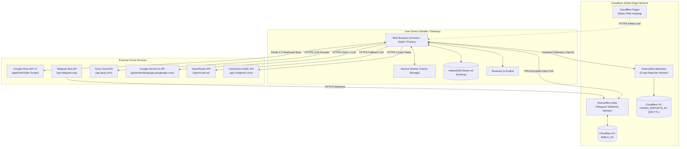
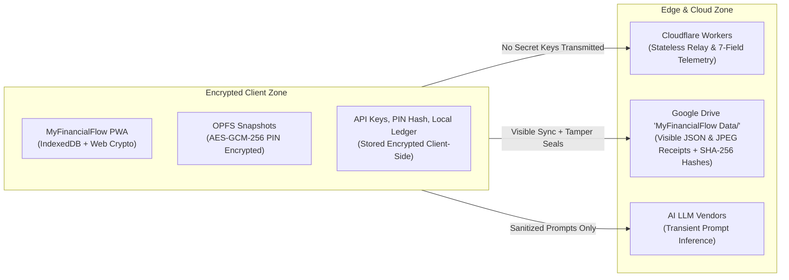

> [!NOTE]
> **Bilingual Documentation / Dokumentasi Dwibahasa**
> - Baca topologi jaringan & deployment ini dalam **Bahasa Indonesia**: [TOPOLOGY.id.md](file:///c:/Personal%20Finance/TOPOLOGY.id.md)
> - Return to Main Documentation: [README.md](file:///c:/Personal%20Finance/README.md)

# MyFinancialFlow — Network & Deployment Topology

This document describes the deployment topology, network boundaries, edge infrastructure, and offline-versus-online operational capabilities of MyFinancialFlow.

---

## 1. Network Topology Overview

MyFinancialFlow operates on a decentralized, client-centric network topology. There is no monolithic application server or hosted backend database. All critical operations take place on the user's client hardware, with lightweight edge workers and Google Drive providing auxiliary cloud services.

---

## 2. Infrastructure Node Specifications

### 2.1 Client Tier
- **Environment**: Modern Web Browser (iOS Safari, Android Chrome, Desktop Chrome/Firefox/Edge).
- **Execution Engine**: JavaScript / WebAssembly (React 19, Tesseract.js WASM).
- **Local Persistence**: IndexedDB via Dexie.js (Schema v8, 23 tables).
- **Asset Caching**: Service Worker caching application shell, CSS, and JS bundles for offline execution.

### 2.2 Cloudflare Pages (Static Hosting)
- **Project**: `financeflow-pwa`
- **Branch**: `myfinanceflow` / `main`
- **Output Directory**: `dist/`
- **Role**: Delivers static application bundle via Cloudflare's global anycast CDN. Zero server-side compute or user data storage.

### 2.3 `financeflow-relay` (Telegram Edge Worker)
- **Runtime**: Cloudflare Workers (V8 Isolate).
- **Binding**: `INBOX_KV` (Cloudflare KV namespace).
- **Inbound Endpoint**: `POST /webhook` (Receives encrypted messages and photos from Telegram Bot API).
- **Outbound Endpoint**: `GET /inbox` (Queried by client PWA with PIN authentication).
- **Security Guarantees**: Stateless, does not log user messages or retain decryption keys.

### 2.4 `financeflow-telemetry` (Crash Reporter Edge Worker)
- **Runtime**: Cloudflare Workers (V8 Isolate).
- **Binding**: `CRASH_REPORTS_KV` (Cloudflare KV namespace).
- **Inbound Endpoint**: `POST /report` (Receives crash diagnostics).
- **Data Retention**: 30-day auto-TTL (`expirationTtl: 2592000`).
- **Sanitization**: Enforces a strict 7-field allow-list (`errorName`, `errorMessage`, `componentStack`, `url`, `userAgent`, `timestamp`, `version`). Completely blocks transaction names, amounts, balances, and credentials.

### 2.5 Google Drive API (`MyFinancialFlow Data/` - `drive.file` Scope)
- **Scope**: `https://www.googleapis.com/auth/drive.file email`
- **Protocol**: REST v3 (JSON files and multipart image uploads).
- **Role**: Visible, accessible cloud storage container for cross-device synchronization and durable receipt storage. Placed in user's root Drive under `MyFinancialFlow Data/` with subfolder `Receipts/YYYY-MM/`.
- **Security Posture (V1.1)**: Synced files and receipt images are unencrypted for user readability and portability, protected by SHA-256 tamper-evidence checksums and HMAC account lock seals. Local on-device storage and local OPFS backups remain 100% encrypted.

---

## 3. Offline vs. Online Capability Matrix

MyFinancialFlow is fundamentally designed to function indefinitely without an internet connection. The table below outlines operational capabilities in offline vs. online states:

| Feature / Subsystem | Offline Capability | Online Capability | Fallback Behavior When Offline |
| :--- | :---: | :---: | :--- |
| **Transaction Logging (Manual)** | 100% | 100% | Writes directly to local IndexedDB. Zero latency. |
| **Account & Ledger Balances** | 100% | 100% | Calculated instantly via local reactive queries. |
| **Analytics, Trends & Charts** | 100% | 100% | Computed entirely client-side using Chart.js. |
| **PPh Tax Estimator** | 100% | 100% | Local dual-ledger calculation and bracket engine. |
| **Financial Goals & Velocity** | 100% | 100% | 90-day velocity calculated from local transaction history. |
| **Investments & Asset Tracking** | 100% (Manual) | 100% + Live FX | Manual valuation works offline; live crypto prices pause. |
| **Cash Flow Forecasting** | 100% | 100% | Local simulation engine runs completely offline. |
| **Gamification, Streaks & Badges**| 100% | 100% | Streak evaluation and badge unlocks run locally. |
| **Receipt OCR (Physical receipts)**| Partial | Full | Uses Tesseract.js offline; uses Gemini Multimodal online. |
| **Receipt Image Viewing** | Cached Only | 100% | Recent/un-pruned receipts viewable offline; pruned receipts stream from Drive online. |
| **AI Conversational Assistant** | Heuristic Only | Full LLM | Simple regex parser offline; Groq/Gemini/OpenRouter online. |
| **Telegram Bot Ingestion** | Paused | Full | Messages buffer in Cloudflare KV; ingested when online. |
| **Cloud Sync (Google Drive)** | Queued | Real-Time | Changes queued in IndexedDB; auto-synced on reconnect. |
| **Data Export (ZIP / JSON)** | 100% | 100% | Archive assembled client-side using native JS Blobs. |
| **Opt-In Crash Reporting** | Queued | Dispatched | Failed dispatches are safely dropped to avoid memory leaks. |

---

## 4. Security Boundaries & Zero-Trust Principles

### Core Security Guarantees:
1. **Zero Secret Keys on Servers**: Your Groq, Gemini, and OpenRouter API keys are never stored on Cloudflare, Google, or any server. They remain exclusively in your browser's IndexedDB.
2. **Visible & Readable Google Drive Sync (V1.1)**: Synced files in `MyFinancialFlow Data/` (`transactions.json`, `accounts.json`, etc.) and receipt images are unencrypted for user transparency and portability. Tamper-evidence is guaranteed via per-file SHA-256 checksums and an authenticated HMAC account lock seal.
3. **Local Encryption Preserved**: The device's local database (IndexedDB) and local OPFS daily snapshots retain full AES-GCM-256 PIN-gated encryption.
4. **Stateless Relay Isolation**: `financeflow-relay` acts strictly as an encrypted queue buffer; worker code does not hold master credentials.
5. **Guaranteed Data Sanitization**: `financeflow-telemetry` strictly strips all financial metrics before persisting crash logs.
